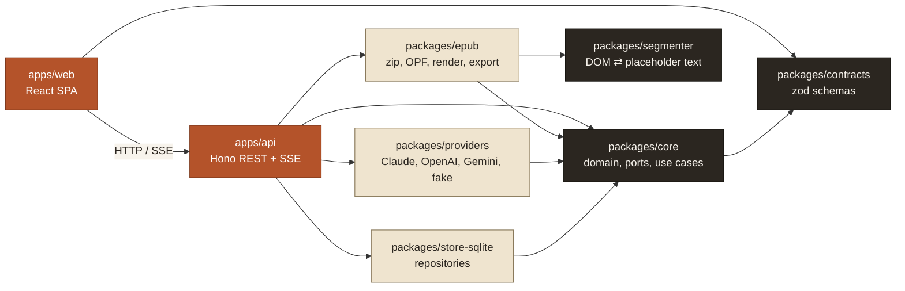

# EPUB Translator

A local web app that takes an EPUB and translates it chapter by chapter into English (or another of 13 target languages) with an LLM (Claude, OpenAI or Gemini). You can read the result side by side with the original, and export it as a valid translated EPUB or as plain text.

- **Formatting is preserved.** Inline formatting (`<em>`, `<span class="tcy">`, links and so on) survives translation as numbered placeholders, which are checked before anything is written.
- **Japanese books work.** Vertical (`vertical-rl`), right-to-left books come out horizontal and left-to-right. Ruby readings (furigana) are never sent to the model.
- **Interruptions are safe.** Every paragraph is stored as it finishes, so an interrupted chapter resumes where it stopped.
- **Prompt caching** (Anthropic) is on, so repeated requests reuse the cached system prompt.

## Setup

Requirements: Node 24 (`nvm use`) and pnpm 10.

```bash
pnpm install
cp apps/api/.env.example apps/api/.env   # add ANTHROPIC_API_KEY (and/or OPENAI_API_KEY, GEMINI_API_KEY)
pnpm dev                                 # api on 127.0.0.1:8787, web on http://localhost:5173
```

Keys stay in `apps/api/.env` on your machine. The browser only sees whether a provider is configured. Data (the SQLite database and uploaded books) lives in `apps/api/data/`.

**Without a key:** set `ENABLE_FAKE_PROVIDER=1` in `apps/api/.env` to get "Offline test (no translation)", which echoes the source with a `[en]` prefix so you can try the whole flow for free.

## Using it

1. **Library:** drop an `.epub` file.
2. **Editor:**
   1. Pick a provider and model.
   2. Use **Translate chapter** (or **Translate all**) and watch the paragraphs fill in.
   3. Use **Glossary** to pin names, and **Edit prompt** for style notes.
   4. Use **Retry** or **Clear** to redo a chapter.
3. **Reader:** choose Translation, Interleaved or Side-by-side view, with font, size, width and theme settings. Move between chapters with ←/→.
4. **Export EPUB** downloads the translated book. Untranslated chapters stay in the source language. **Export TXT** gives plain text.

## Architecture



- **`core` is pure.** It holds the domain types, the ports (`EpubParser`, `ChapterRenderer`, `EpubExporter`, `TranslationProvider`, repositories) and the use cases (import, workspace, `JobRunner`, render, export). It has no I/O, and Biome enforces that.
- **Adapters implement the ports.** `apps/api/src/services.ts` is the only place they are wired together.
- **`apps/web` talks to the API only through `@et/contracts`.**

See `docs/CODING-STANDARDS.md` for the rules, `docs/research/` for the design research and `docs/plan/` for the implementation plan.

## Extending

- **Another target language:** add an entry to `TARGET_LANGUAGES` in `packages/contracts/src/languages.ts` (code, name, `dir`, `writingMode`). The prompt, export metadata and spine direction follow from it.
- **Another LLM provider:**
  1. Implement `TranslationProvider` in `packages/providers/src/<name>.ts`: `listModels()`, plus `translateSegments()` returning a `SegmentBatchResult`.
  2. Add it to `buildProviderRegistry`, and add its id to `ProviderIdSchema`.
  3. Use cases need no changes.

## Development

```bash
pnpm test        # vitest across all packages
pnpm typecheck
pnpm lint        # biome (pnpm format to fix)
```

To run a live provider smoke test, set `LIVE=1` plus the provider's key and run `pnpm --filter @et/providers test`. It spends a few hundred tokens.
