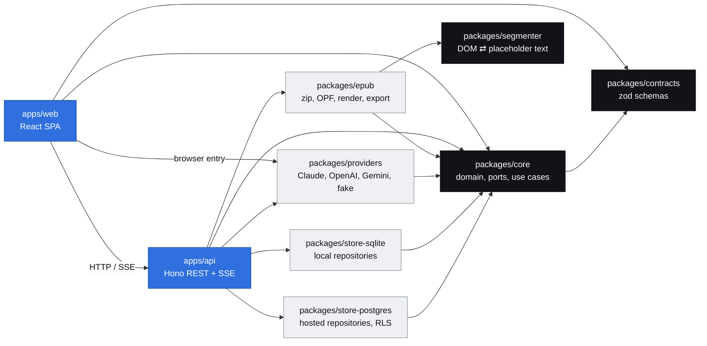

# EPUB Translator

[](https://github.com/AbhinavMV/epub-translator/actions/workflows/ci.yml)

A local web app that takes an EPUB and translates it chapter by chapter into English (or another of 13 target languages) with an LLM (Claude, OpenAI or Gemini). You can read the result side by side with the original, and export it as a valid translated EPUB or as plain text.

- **Formatting is preserved.** Inline formatting (`<em>`, `<span class="tcy">`, links and so on) survives translation as numbered placeholders, which are checked before anything is written.
- **Japanese books work.** Vertical (`vertical-rl`), right-to-left books come out horizontal and left-to-right. Ruby readings (furigana) are never sent to the model.
- **Interruptions are safe.** Every paragraph is stored as it finishes, so an interrupted chapter resumes where it stopped.
- **Prompt caching** (Anthropic) is on, so repeated requests reuse the cached system prompt.
- **AI proofreading is opt-in and reviewable.** A second pass checks the translation against the original and proposes edits with a reason. Nothing changes until you accept a suggestion.
- **Runs locally or hosted.** Locally, keys stay in a `.env` file on your machine. The invite-only hosted mode (Vercel + Supabase) keeps each user's keys in their own browser.

## Setup

Requirements: Node 24 (`nvm use`) and pnpm 10.

```bash
pnpm install
cp apps/api/.env.example apps/api/.env   # add ANTHROPIC_API_KEY (and/or OPENAI_API_KEY, GEMINI_API_KEY)
pnpm dev                                 # api on 127.0.0.1:8787, web on http://localhost:5173
```

Keys stay in `apps/api/.env` on your machine. The browser only sees whether a provider is configured. Data (the SQLite database and uploaded books) lives in `apps/api/data/`.

**Upgrading a library from before projects:** stop the API, then run `pnpm --filter @et/api backfill:projects --sqlite data/translator.db` and then `pnpm --filter @et/api merge:project-settings --sqlite data/translator.db`, in that order (the path is relative to `apps/api`). Each prints what it would do; add `--apply` to write. The SQLite schema upgrades itself when the API, or either script with `--apply`, opens the file.

- The backfill places every book in a project, grouping books by series title and reading each volume number from the title. Run it again after upgrading from an earlier projects build: it records each project's series title, which upload uses to find a project whose books were all deleted.
- The merge moves the glossary and custom prompt each book had before projects onto its project; translations use no glossary or custom prompt until it runs. Where volumes disagree on a term, the higher volume's rendering stays in force and the others are recorded as a glossary conflict. It writes nothing while a book has no project, skips a project whose glossary or custom prompt has already been saved, and leaves out a project whose merged glossary exceeds 2,000 entries.

**Without a key:** set `ENABLE_FAKE_PROVIDER=1` in `apps/api/.env` to get "Offline test (no translation)", which echoes the source with a `[en]` prefix so you can try the whole flow for free.

## Using it

Every page has the same header: the app mark (back to the library), a breadcrumb (**Library / project / Vol. N**) and one **Settings** menu. Settings holds the theme (Light, Sepia, Dark, or System, which follows the device), and in hosted mode **API keys**, **Admin** (admins only) and **Sign out**. On touch screens, phones and tablets alike, buttons and menu items are 44 px tall.

1. **Library:** lists your projects as cards of equal height: the cover, the name (two lines at most; the full name is in its tooltip) and one status line with a bar: "2 of 4 volumes translated", "✓ Fully translated" (naming the language when it is not English; every volume completely translated into one language, flagged passages counting) or "Not started". Progress counts the project's main language. **Search projects** matches a project's name or its series title. **Continue where you left off** reopens the volume and chapter you last had open on this device, with **Read** and **Translate**; it is stored in the browser, not synced. An empty library explains how to start.
   - **Upload EPUB** opens a two-step dialog. First choose an `.epub` file, or drop it on the dialog; on a desktop you can also drop it anywhere on the library or a project page. Then pick where it goes: **Add to project** suggests the project with the same series title (the book's title without its volume marker), or **New project** named after the series; you can pick any project instead, and a file dropped on a project page goes to that project. **Volume number** is read from the title; left empty, the book becomes volume 1, or the next number after the project's highest volume. Volume numbers may be fractional (2.5). **Add volume** uploads it and opens the project. A file already in your library is not added twice.
2. **Project:** the glossary and custom prompt belong to the project, so every volume uses the same terms.
   - **Glossary → Suggest from volume** samples a volume and proposes names and terms the glossary lacks, using a cheap model. Pick the sample size first: Standard (about 12,000 characters), Large (about 40,000, the default) or Entire volume, which sends one request per 40,000-character chunk; the request count and characters show before you start. The volume picker also offers **All volumes** (the button then reads **Suggest from all volumes**), which samples every volume in volume order at the chosen size and shows the volume count too (for example "5 volumes · 27 requests · ~1,100,000 chars"); progress reads "Suggesting… volume 2 of 5". Results from each chunk and volume are merged into one list, with the earliest rendering winning, and **Stop** (or a failed request) keeps what was gathered so far. Each request returns at most 60 suggestions, and the glossary still holds at most 2,000 entries; when adding suggestions would pass that, the ones that fit are added and a notice says how many were left out. Suggested renderings follow the custom prompt and match the renderings already in the glossary, so names, honorifics and forms of address stay consistent. Review the suggestions, then save. **Custom prompt** shows the fixed fidelity and format rules read-only, worded for any source and target language since every translation of the project shares them, and lets you replace the default style guidance with your own custom prompt.
   - The glossary editor lists any glossary conflicts left by merging volumes' old glossaries, with each rendering and its volume. The one marked in force is used until you pick one.
   - Edits apply from the next chapter or work unit; running chapters and submitted batches keep what they started with. Changing a glossary entry does not retranslate earlier volumes.
   - The pencil and bin beside the name rename and delete the project. Once a volume has an English translation of its title, **Use translated title** opens the rename field filled with the lowest-numbered such volume's translated title, volume marker removed; nothing changes until you save.
   - Each volume card shows the volume's translated title once there is one (the original is in its tooltip), and a **Translated** badge once the volume is completely translated, naming the language when it is not English.
   - Change a volume's number, move a volume to another project (it carries no glossary entries with it), or delete a volume. Deleting the project deletes all its volumes and their translations.
3. **Editor:**
   - **Choosing how to translate:**
     - Pick a provider and model, and choose **Live** or **Batch**. Batch uses the provider's batch API: it costs 50% less and returns results within 24 h. The project in the breadcrumb opens the book's project to edit its glossary and custom prompt, and **Read** opens the reader at the current chapter.
   - **Translating:**
     - **Translate chapter** translates the current chapter. **Translate all** does every chapter, starting with **Book title & navigation** (book title, author, publisher, TOC labels; listed first in the chapter rail), so translated titles appear early. **Translate title & contents** does just that part.
     - The button changes as a chapter progresses: **Translated**, **Continue**, **Retry N failed** (re-sends only failed passages) or **Try again**.
     - The chapter list shows each chapter's status (translated, partly translated, has failed passages, or not started) with its passage count. A chapter shows its translated title once one exists, otherwise its original title. On a phone, **Open chapters** opens the list as a sheet.
   - **When something fails:**
     - A failed passage says why, for example that the model declined it and under which policy category.
     - Errors that stop a chapter (bad key, rate limits) appear in a banner with a fix hint. A fatal error also stops the rest of that job's queue.
   - **Proofreading:**
     - **Proofread** checks this chapter, the chapters not yet proofread, or the whole book. Chapters run one at a time and carry names forward so they stay consistent. Multi-chapter runs ask first, because each sends the chapter text again.
     - Suggestions are tagged accuracy, consistency, terminology or fluency, and show as word diffs with a reason. Accept or reject them one by one or all at once.
     - Edits are vetted before they are shown (inline placeholders must still match the source). A suggestion whose paragraph changed since proofreading is marked outdated rather than applied.
4. **Reader:**
   - Views: Translation, Interleaved or Side-by-side.
   - Contents lists the chapters with their status. It sits beside the text from 768 px and opens as a sheet from the **Contents** button on a phone.
   - Layouts: **Scroll** or **Paged** (←/→, Space, tap or swipe).
   - Settings: font, size, width and theme (the same theme as the Settings menu).
5. **Export:**
   - **Export EPUB** (translation only or **Bilingual**) downloads the book with translated metadata. The originals are kept as `alternate-script` entries.
   - **Export TXT** gives plain text.
   - Untranslated chapters stay in the source language.

## Hosted mode

The same app can run invite-only on Vercel Hobby with Supabase Free: private library per user, translation in the browser with each user's own provider keys, EPUBs and exports through signed Storage URLs. See [docs/deploy-vercel-supabase.md](docs/deploy-vercel-supabase.md).

## Architecture



- **`core` is pure.** It holds the domain types, the ports (`EpubParser`, `ChapterRenderer`, `EpubExporter`, `TranslationProvider`, `Proofreader`, repositories) and the use cases (import, workspace, `JobRunner`, proofread, render, export). It has no I/O, and Biome enforces that.
- **Adapters implement the ports.** `apps/api/src/compose-local.ts` (SQLite, files on disk, server-side keys) and `compose-hosted.ts` (Postgres, Supabase Storage and Auth) are the only places they are wired together.
- **`apps/web` talks to the API through `@et/contracts`.** In hosted mode it also runs translation and proofreading itself, using the I/O-free parts of `@et/core` and the browser-safe `@et/providers/browser` entry.

See `docs/CODING-STANDARDS.md` for the rules, `docs/research/` for the design research and `docs/plan/` for the implementation plan.

## Extending

- **Another target language:** add an entry to `TARGET_LANGUAGES` in `packages/contracts/src/languages.ts` (code, name, `dir`, `writingMode`). The prompt, export metadata and spine direction follow from it.
- **Another LLM provider:**
  1. Implement `TranslationProvider` in `packages/providers/src/<name>.ts`: `listModels()`, plus `translateSegments()` returning a `SegmentBatchResult`.
  2. Optionally add the matching batch provider (`batch/`), glossary term extractor (`terms/`) and `Proofreader` (`proofread/`).
  3. Add it to `buildProviderRegistry` and, for hosted mode, `createBrowserProvider` in `packages/providers/src/browser.ts`, and add its id to `ProviderIdSchema`.
  4. Use cases need no changes.

## Development

```bash
pnpm test        # vitest across all packages
pnpm typecheck
pnpm lint        # biome (pnpm format to fix)
```

`pnpm install` points git at `.githooks/`, whose pre-commit hook runs `biome check` on the staged files and stops a commit that fails lint or formatting.

**Mock API:** `VITE_MOCK_API=1 pnpm --filter @et/web dev` runs the web app on an in-memory API (`apps/web/src/api/mock.ts`), with no server and no keys. It is seeded from `apps/web/src/api/mock-seed.ts` with the states layout checks need: very long project and volume titles, a project fully translated into French, a partly translated project whose volumes (numbered 1, 2, 2.5 and 3) are translated, partly translated and untranslated, a not-started project, a one-volume project, an empty glossary, a glossary conflict, a chapter with failed passages (Vol. 2.5, chapter 2) and pending proofread suggestions (Vol. 1, chapter 1). The data resets on every page load.

Add `?hosted=1` to any URL to make the mock behave like hosted mode: a signed-in admin, the account items in the Settings menu, API keys (kept in memory only), the Admin page with sample invites and users, and the hosted upload wording. `?hosted=signed-out` starts signed out, so `/signin` renders, and any email and password then sign in. The choice is kept in `localStorage` until `?hosted=0` turns it off. Translation in this mode still runs on the mock, not in the browser.

**Width sweep:** `pnpm --filter @et/web sweep` builds the web app on the mock API, serves it on a free port (set `SWEEP_PORT` to pick one) and loads every route and every dialog, sheet, menu and popover the seeded data reaches, local and hosted, at 19 widths from 280 to 1,920 px in light and dark. It fails when an element extends past the viewport, the page scrolls sideways, or a box's content is wider than the box (scrolls, clips or spills), naming the screen, theme, width and element. The first run needs `pnpm --filter @et/web exec playwright install chromium`. CI runs it in the `width-sweep` job. An element meant to scroll or clip sideways carries `data-overflow="scroll"` or `data-overflow="clip"`; text inputs are exempt. Overflow on screens not yet redesigned is listed in `apps/web/e2e/width-sweep/expected-failures.ts`, keyed by screen, element and width band (280–639, 640–1,023, 1,024–1,920 px); the sweep also fails when a listed failure no longer happens, so remove its entry when you fix a screen. `SWEEP_IGNORE_EXPECTED=1` shows every failure regardless of the list. New screens or overlays go in `apps/web/e2e/width-sweep/screens.ts`.

To run a live provider smoke test, set `LIVE=1` plus the provider's key and run `pnpm --filter @et/providers test`. It spends a few hundred tokens.
